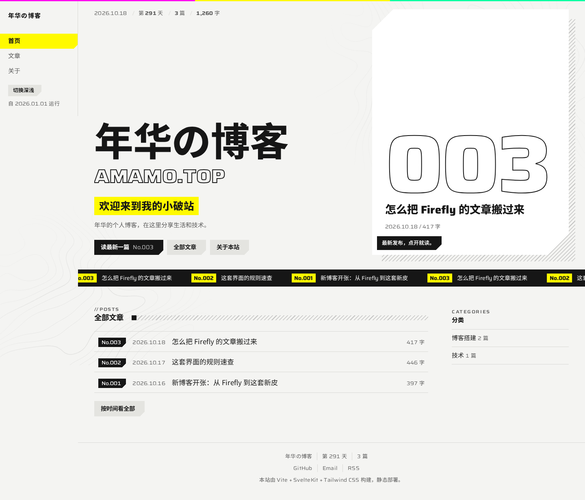
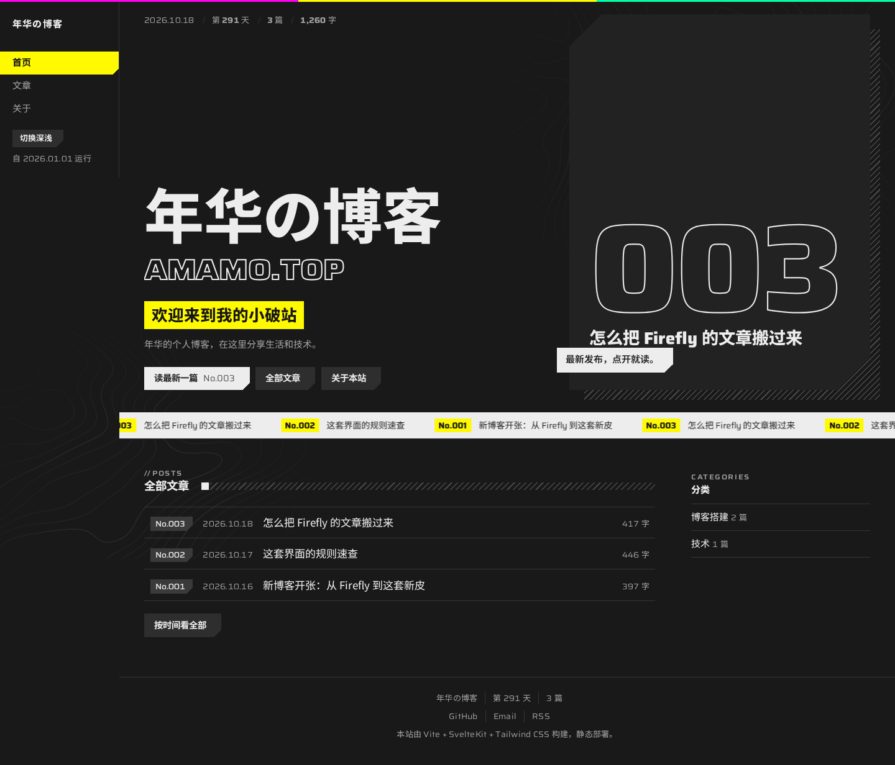
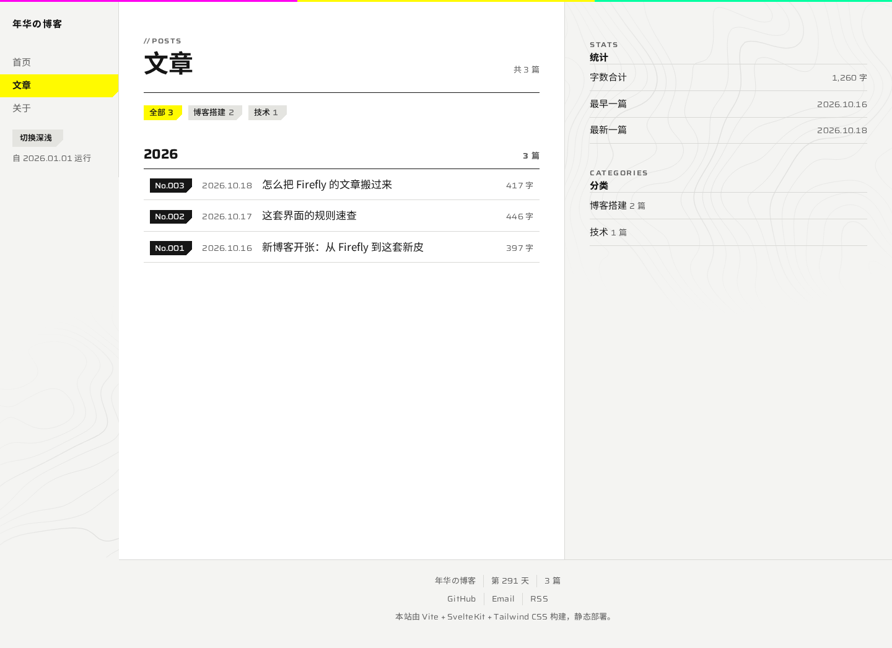
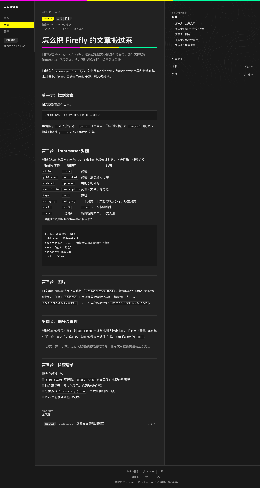
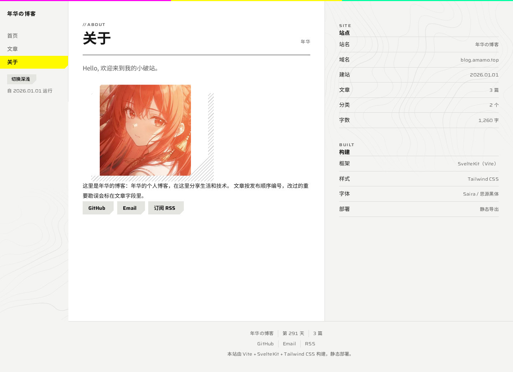

# 年华の博客

## 预览

| 首页（浅色） | 首页（深色） |
| --- | --- |
|  |  |

| 文章列表（浅色） | 文章详情（深色） |
| --- | --- |
|  |  |

| 关于 | 手机（390px） |
| --- | --- |
|  |  |

用 Vite + SvelteKit + Tailwind CSS 重做的个人博客，界面是一套"工业手册"的味道：纸底墨线、一种黄色高亮、切角按钮、真实编号。

```sh
pnpm install      # 装依赖
pnpm dev          # 开发服务器
pnpm build        # 静态导出到 build/
pnpm preview      # 本地预览 build/
pnpm check        # 类型检查
```

## 配置文件（src/config/）

| 文件 | 内容 |
| --- | --- |
| `siteConfig.ts` | 站名、域名、副标题、描述、建站日期 |
| `profileConfig.ts` | 名字、签名、头像、联系方式 |
| `navConfig.ts` | 侧栏导航项 |
| `postConfig.ts` | 阅读速度、是否显示字数 |
| `footerConfig.ts` | 页脚说明、运行天数开关 |
| `index.ts` | 统一出口，组件从 `#config` 取 |

## 写文章

markdown 放进 `src/content/posts/`，frontmatter 认这些字段：

```yaml
---
title: 标题              # 必填
published: 2026-10-18    # 必填，决定编号顺序
updated: 2026-10-19      # 可选，有勘误时写
description: 一句话导语   # 可选，文章页和列表导语
tags: [标签A, 标签B]      # 可选
category: 分类           # 可选，默认"未分类"
draft: true              # 可选，true 不会构建
---
```

编号（`No.001` 起）、字数、阅读时长、分类计数、运行天数全部在构建时从文件算出来，不要手写。

## 迁移旧文章

旧博客在 `/home/qwc/Firefly/src/content/posts/`（跳过 `guide/`，那是主题自带示例）。搬一篇文章：

1. markdown 复制进 `src/content/posts/`，**文件名就是 URL**（`foo.md` → `/posts/foo/`）；
2. frontmatter 只留新站认的字段：`title`/`published`/`updated`/`description`/`tags`/`category`/`draft`，`image`、`author`、`lang` 这些丢掉；
3. 旧文里的 `./images/x.png` 拷到 `static/posts/<文件名>/`，正文路径改成 `/posts/<文件名>/x.png`；
4. `category` 有多个时只取主分类。

编号、字数、分类计数都按 `published` 重新算，不用改任何 `No.`。

## 样式在哪改

- 颜色、部件：`src/lib/styles/endfield.css`（套件，全站唯一来源）；
- 页面布局：各页面的 `<style>` 块，只写网格和间距；
- Tailwind 颜色映射、代码块样式：`src/app.css`；
- 小动效：`src/lib/fx.js`（深浅切换、数字落定、视差）。

变体设置只在 `src/app.html` 的 `<html>` 属性上（`data-ef-*`），别处不再改颜色。

## 部署

`pnpm build` 产出 `build/`，纯静态，Vercel / Cloudflare Pages / EdgeOne 直接指过去；未匹配的路径会落到 `404.html`。
